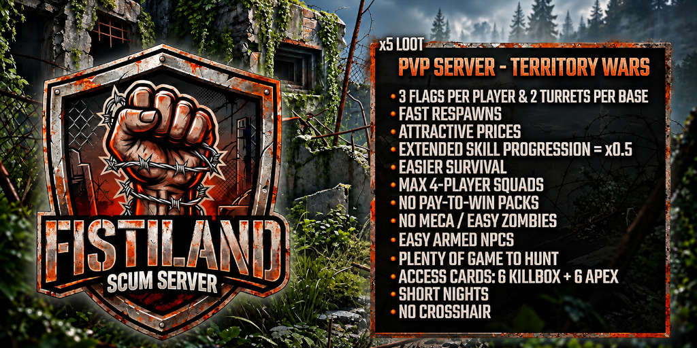

# FISTILAND

**EU PvP SCUM server built around territory wars.** Hold zones, defend your base, fight over cargo drops. Survival is easier so the fight is the point.

[Join the Discord](https://discord.gg/UdHGdRSyyu){ .md-button .md-button--primary }
[How to join](join.md){ .md-button }

## At a glance

| | |
|---|---|
| Slots | 14 |
| Region | EU |
| Mode | Full PvP, territory wars |
| Loot | x5 |
| Squads | 4 players max |
| Skill progression | Extended (x0.5) |

## Where to start

- [Server overview](server/overview.md): what is different from a stock server.
- [Territory wars](server/territory-wars.md): flags, turrets, cargo drops.
- [Survival and enemies](server/survival.md): zombies, armed NPCs, nights.
- [How to join](join.md)

!!! note
    The server is being tuned. Settings listed on this wiki may change; the Discord announces changes.
