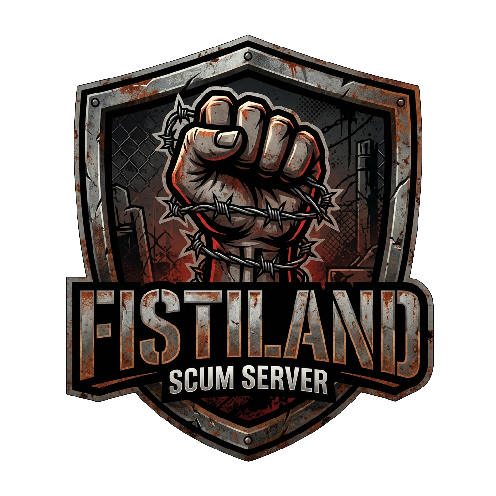

---
hide:
  - navigation
  - toc
---

  
  
EU &middot; PvP &middot; Territory wars

  <h1 class="fl-title">FISTILAND</h1>
  
Hold zones, defend your base, fight over cargo drops. Survival is easier, so the fight is the point.

  <a class="fl-btn" href="join/">How to join</a>
  <a class="fl-btn ghost" href="https://discord.gg/UdHGdRSyyu">Discord</a>

  
<b>14</b>Slots

  
<b>EU</b>Region

  
<b>PvP</b>Full PvP

  
<b>x5</b>Loot

  
<b>4</b>Squad max

## What makes it different

:material-flag: 
### Territory wars
3 flags per player, 2 turrets per base. Take ground, hold it, lose it.

:material-timer-sand: 
### Fast respawns
A lost fight costs you minutes, not an evening.

:material-tag-multiple: 
### Attractive prices
Cheaper traders, so gear comes in hours, not weeks.

:material-chart-line: 
### Long skill progression
Skills build at x0.5. Gear is quick, mastery takes time.

:material-shield-account: 
### Easier survival
Short nights and relaxed survival, so the PvP stays in front.

:material-skull-crossbones: 
### Easy enemies
Easy zombies and easy armed NPCs, with plenty of game to hunt.

:material-robot-off: 
### No mechs
The fights stay between players.

:material-key-variant: 
### Access cards
6 Killbox and 6 Apex cards available at the same time.

:material-cash-remove: 
### No pay-to-win
No pay-to-win packs. No crosshair.

## The server in one picture

## Ready to fight for ground?

Find **FISTILAND** in the SCUM server list, or come to the Discord for news and squad searches.

<a class="fl-btn" href="https://discord.gg/UdHGdRSyyu">Join the Discord</a>
<a class="fl-btn ghost" href="server/overview/">Server overview</a>

